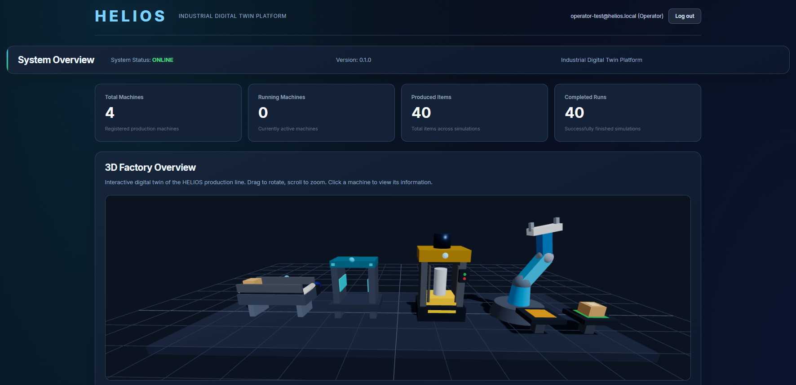
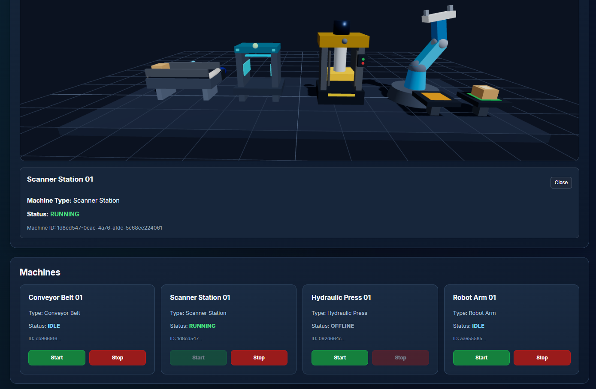
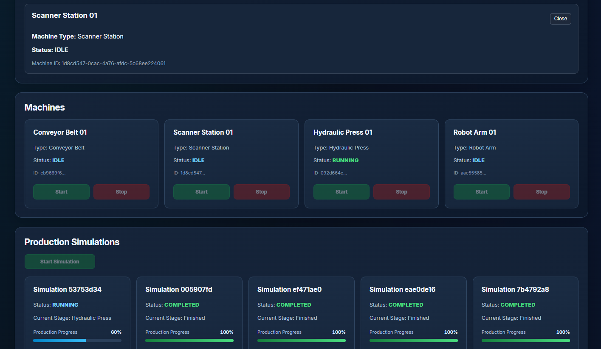
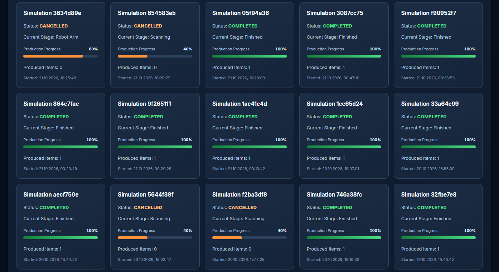
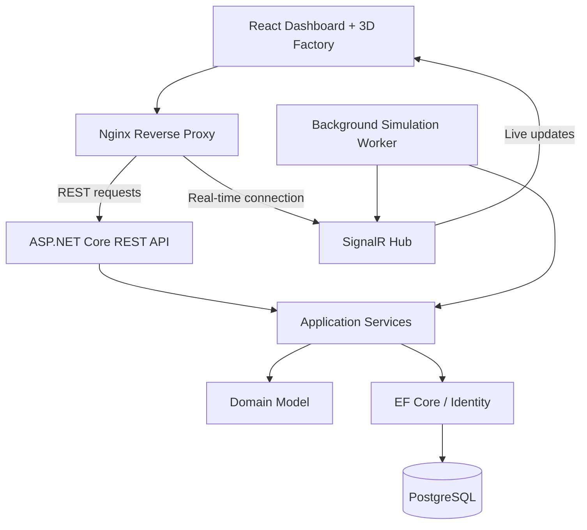

# HELIOS – Industrial Digital Twin Platform

A full-stack industrial simulation platform featuring an interactive 3D production line, real-time monitoring, role-based access control, and automated production workflows.

HELIOS demonstrates modern software engineering by combining backend architecture, frontend development, database management, real-time communication, 3D visualization, containerization, and automated testing.

> **Project status:** Functional portfolio MVP.
> HELIOS simulates an industrial production environment. It does not control physical machinery.

## Screenshots

### Dashboard Overview

Monitor production statistics, machine activity, and system status through the HELIOS dashboard.



### Interactive 3D Factory

Explore the production line in 3D, select machines, and monitor their status in real time.



### Production Simulation

Track production runs through individual manufacturing stages with live status updates and progress indicators.



### Simulation History

Review completed and cancelled simulation runs, production results, and progress history.



---

## Features

### Interactive 3D Factory

Explore a virtual industrial production line directly in the browser.

- Custom 3D assets created in Blender and exported as GLB
- Interactive camera controls and machine selection
- Animated conveyor belt, scanner, and hydraulic press
- Animated robotic arm with pick-and-place functionality
- Visual synchronization with production stages
- Lazy-loaded 3D scene with dedicated error handling

### Production Simulation

The production workflow includes five stages:

1. Conveyor Belt – Workpiece transportation
2. Scanner Station – Workpiece scanning
3. Hydraulic Press – Processing operation
4. Robot Arm – Pick-and-place operation
5. Finished – Completed production cycle

The simulation state is managed by the backend and persisted in PostgreSQL.

### Live Dashboard

- Machine status overview
- Production statistics and KPI cards
- Active and completed simulation runs
- Interactive 3D production visualization
- Real-time updates through SignalR
- Automatic synchronization after SignalR reconnection

### Authentication and Authorization

HELIOS uses ASP.NET Core Identity and JWT authentication.

Supported roles:

| Role | Permissions |
|------|-------------|
| Viewer | View dashboards, machines, and simulations |
| Operator | View data and operate supported machine and simulation controls |
| Admin | Administrative authorization for supported operations |

Access restrictions are enforced by the backend.

## Technology Stack

| Layer | Technologies |
|-------|-------------|
| Frontend | React 19, TypeScript, Vite |
| 3D Visualization | Three.js, React Three Fiber, Drei |
| 3D Modeling | Blender, GLB/glTF |
| Backend | C#, ASP.NET Core 9 |
| Architecture | API, Application, Domain, Infrastructure |
| Real-Time | ASP.NET Core SignalR |
| Authentication | ASP.NET Core Identity, JWT |
| Database | PostgreSQL 17 |
| ORM | Entity Framework Core 9 |
| Frontend Testing | Vitest, React Testing Library |
| Backend Testing | xUnit, ASP.NET Core Integration Tests |
| Containerization | Docker, Docker Compose, Nginx |
| CI | GitHub Actions |
| Version Control | Git, GitHub |

## Architecture

HELIOS follows a modular monolith architecture with separated application layers.



The backend owns simulation state and business logic. The frontend visualizes the current production state and sends authorized control requests.

## Project Structure

```text
HELIOS/
├── backend/
│   ├── Helios.Api/
│   ├── Helios.Application/
│   ├── Helios.Domain/
│   └── Helios.Infrastructure/
├── frontend/
│   ├── public/
│   │   └── models/
│   └── src/
│       ├── components/
│       ├── services/
│       └── test/
├── tests/
│   └── Helios.Tests/
├── docs/
├── .github/
│   └── workflows/
│       ├── backend-ci.yml
│       └── frontend-ci.yml
├── docker-compose.yml
└── HELIOS.sln
```

## Running with Docker

### Prerequisites

- Docker Desktop with Docker Compose
- Git

### Configuration

Create a `.env` file in the project root containing:

```dotenv
POSTGRES_PASSWORD=your_secure_database_password
JWT_KEY=your_base64_encoded_jwt_secret
JWT_ISSUER=HELIOS
JWT_AUDIENCE=HELIOS.Frontend
```

Generate a cryptographically secure JWT signing key containing at least 32 random bytes, encoded as Base64.

Do not commit `.env`, passwords, or JWT signing keys to version control.

### Start the Application

```bash
docker compose up -d --build
```

Open the application at:

**http://localhost:8080**

The Docker environment contains:

| Service | Port |
|---------|------|
| React Frontend / Nginx | 8080 |
| ASP.NET Core API | 5001 |
| PostgreSQL | 5432 |

Services are bound to localhost in the development Compose configuration.

### Database Initialization and First Operator

HELIOS supports automatic database initialization for local Docker deployments.

When `Helios__InitializeDatabase=true` is enabled in `docker-compose.yml`, the API automatically:

1. Applies all pending Entity Framework Core migrations.
2. Creates the `Admin`, `Operator`, and `Viewer` roles.
3. Seeds the four demonstration machines if the machine table is empty.

Database initialization is designed to be repeatable without deleting existing data.

**First user setup**

No default user accounts or passwords are created.

1. Start HELIOS using `docker compose up -d --build`.
2. Register your first account using `POST /api/auth/register`. New accounts receive the `Viewer` role.
3. Promote that account to the initial Operator by running:

```bash
docker compose run --rm --no-deps api --bootstrap-operator your-email@example.com
```

Replace `your-email@example.com` with the email address used during registration.

This administrative bootstrap command can only succeed if no Operator or Admin already exists. It does not change the user's password and exits without starting the API server.

**Security note:** The bootstrap command is intended for trusted local administration. It is not exposed as a public API endpoint.


### Stop the Application

```bash
docker compose down
```

The PostgreSQL data is persisted in a named Docker volume. Do not use `docker compose down -v` unless you intentionally want to remove that data.

## Local Development

Requirements:

- .NET 9 SDK
- Node.js 24
- PostgreSQL 17

Start the PostgreSQL database:

```bash
docker compose up -d postgres
```

Run the backend from the project root:

```bash
dotnet run --project backend/Helios.Api --urls http://localhost:5000
```

Run the frontend in a separate terminal:

```bash
cd frontend
npm ci
npm run dev
```

Open:

**http://localhost:5173**

The Vite development server proxies `/api` and `/hubs` requests to the backend.

**Important:** Avoid running the local backend and the Docker API against the same database simultaneously. Both instances run a background simulation worker, and concurrent workers are not yet coordinated.

## API and Real-Time Communication

Examples of implemented API routes:

```http
POST /api/auth/login
GET  /api/system/status
GET  /api/machines
GET  /api/simulations
```

SignalR hub:

```text
/hubs/helios
```

Protected endpoints require a valid JWT access token.

SignalR broadcasts notifications when machines or simulations change. The frontend retrieves updated data to synchronize its dashboard.

## Automated Testing

### Backend

Run the backend test suite:

```bash
dotnet test HELIOS.sln --configuration Release
```

### Frontend

```bash
cd frontend
npm ci
npm run lint
npm test
npm run build
```

The project currently includes backend integration and domain tests as well as frontend authentication and permission tests.

## Continuous Integration

GitHub Actions runs automated validation for pushes and pull requests targeting `main`.

**Backend CI**
- Dependency restore
- .NET Release build
- Automated backend tests

**Frontend CI**
- Dependency installation
- ESLint
- Vitest
- TypeScript and Vite production build

CI workflows are located in `.github/workflows/`.

## Current Limitations

- The simulation uses virtual production data rather than physical machine telemetry.
- Multiple backend instances must not operate the same simulation concurrently.
- Initial Operator provisioning requires an explicit local bootstrap command. No default accounts or passwords are provided.
- The 3D visualization is loaded separately and remains the largest JavaScript bundle.

## Project Purpose

HELIOS is a software engineering portfolio project built to demonstrate practical experience with:

- Full-stack application development
- Clean separation of application layers
- REST APIs and real-time communication
- Authentication and role-based authorization
- Relational databases and persistence
- Interactive 3D visualization
- Automated tests and CI
- Docker-based deployment
